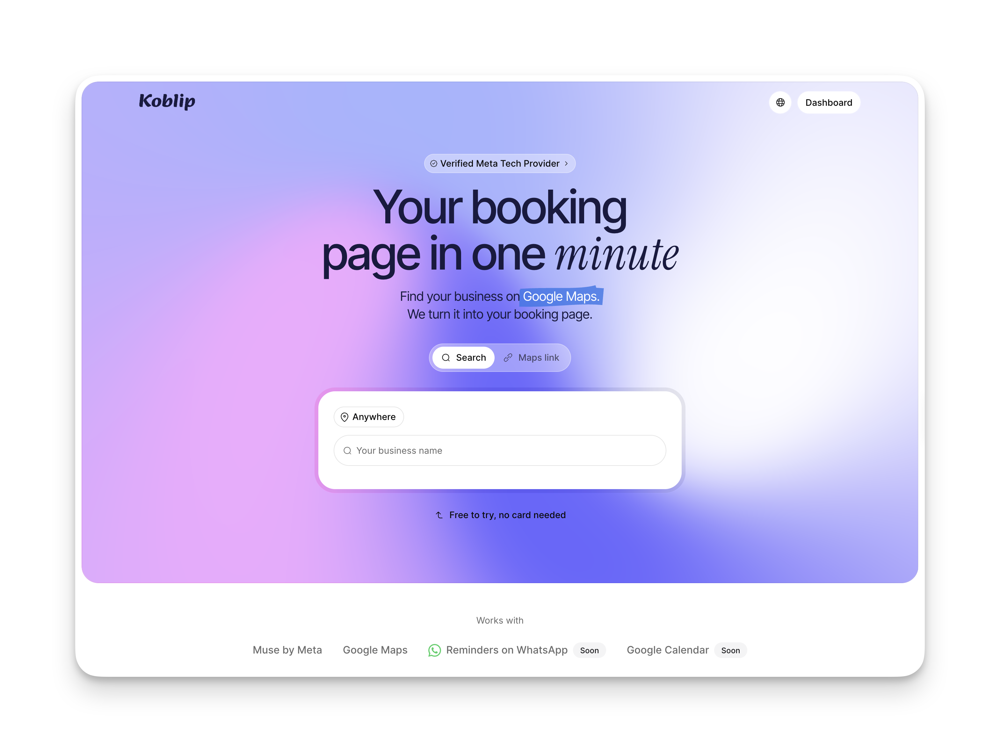

<h1 align="center">Koblip Book</h1>

<p align="center">
  <strong>Your booking page in one minute.</strong><br>
  Find your business on Google Maps. Share your page. Manage the day by typing or talking.
</p>

<p align="center">
  <a href="https://book.koblip.com"><strong>Try Koblip Book →</strong></a> ·
  <a href="docs/README.md">Documentation</a> ·
  <a href="docs/setup.md">Run locally</a>
</p>

<p align="center">
  <a href="https://github.com/MackentochKelly/koblip-book/actions/workflows/ci.yml">
    
  </a>
</p>

<p align="center">
  <a href="https://book.koblip.com">
    
  </a>
</p>

## Less scheduling. More time for your business.

Koblip Book helps local businesses get online and take appointments. Customers book through a public page; owners manage bookings, services, opening hours, customers and team from one dashboard.

| Start                                                     | Share                                                                  | Manage                                                    |
| --------------------------------------------------------- | ---------------------------------------------------------------------- | --------------------------------------------------------- |
| Find your business by name or paste its Google Maps link. | Give customers a booking page with services, team and available times. | Use the dashboard or ask your assistant by text or voice. |

- **An assistant that works with your business:** looks up bookings and helps manage appointments, services and hours. Actions that need confirmation show a card for the owner to approve.
- **English and Spanish:** for customer pages and the owner experience.
- **Phone first:** with desktop layouts and light and dark themes.

## Built for the Meta Global AI Developer Hackathon

Everything in this repository was built during the Hackathon (October 26 – November 4, 2026). The first commit is dated **October 26, 2026**, and the [commit history](https://github.com/MackentochKelly/koblip-book/commits/main) shows each step since.

### What existed before the Hackathon

**Koblip Chat**, a separate WhatsApp product with its own repository (first commit June 4, 2026), is not part of this submission. Koblip Book sends and receives WhatsApp messages through its public API. Book's WhatsApp features (booking messages, reminders, automatic replies and flows) are in this repository and were built during the Hackathon.

### How Koblip Book uses Meta's models

All calls go through the Meta Model API; the model names live in one place, [`lib/meta-ai.ts`](lib/meta-ai.ts).

| Model | What it does in Koblip Book | Code |
| --- | --- | --- |
| **Muse Spark** (`muse-spark-1.3`, and `muse-spark-1.2` for the first step of a spoken answer) | The owner's assistant: reads and manages bookings, services and hours with 50 tools, plus 3 of its own for asking the owner and hearing a yes or a no, by text or voice. Changes wait for the owner's approval on a confirm card | [`run-chat.ts`](features/assistant/api/run-chat.ts) |
| **Muse Spark** | Writes a business's "About" text from its Google Maps details during setup | [`write-about.ts`](features/place-import/api/write-about.ts) |
| **Muse Spark** | Suggests services and add-on groups for a new business | [`actions.ts`](features/dashboard/api/actions.ts), [`addon-actions.ts`](features/dashboard/api/addon-actions.ts) |
| **Muse Spark** | Drafts a new business's starter services, extras, prices, team and policies during setup | [`draft-catalog.ts`](features/starter-catalog/api/draft-catalog.ts), [`draft-policies.ts`](features/starter-catalog/api/draft-policies.ts) |
| **Muse Image** (`muse-image-1.0`) | Draws starter team photos during setup | [`draw-portrait.ts`](features/starter-catalog/api/draw-portrait.ts) |
| **Muse Spark** | Translates services and business details from English into Spanish | [`translate.ts`](features/dashboard/utils/translate.ts) |
| **Muse Voice Transcribe** (`muse-voice-transcribe-1.0`) | Hears the owner live in talking mode, through Book's own voice relay | [`voice-relay.mjs`](server/voice-relay.mjs) |

Spoken replies use ElevenLabs.

[Explore the app](https://book.koblip.com) · [Assistant design notes](docs/assistant-plan.md)

## Built by Mackentoch Kelly Begin

Founder of Koblip. Building software that helps businesses work with less friction.

[X](https://x.com/keke_tuto) · [GitHub](https://github.com/MackentochKelly) · [LinkedIn](https://www.linkedin.com/in/mkellybegin/)

<details>
<summary><strong>Development · local setup, architecture and checks</strong></summary>

### Run locally

Use **Node.js 24**, as specified in `.nvmrc` and CI.

```bash
npm ci
cp .env.example .env.local
mkdir -p data
```

Fill in the settings described in [Local setup](docs/setup.md), then run:

```bash
npm run db:migrate
PORT=3100 npm run dev
```

Open [localhost:3100](http://localhost:3100). Google search, model responses, spoken replies and email each require their own credentials; see the setup guide.

### Project structure

```text
app/           Routes, layouts and API endpoints
features/      Feature code, translations and colocated tests
components/    Shared components; UI primitives in components/ui
hooks/         Shared React hooks
lib/           Shared services, rules, database schema and utilities
server/        Live voice WebSocket relay
drizzle/       Database migrations
public/        Static assets and audio worklet
scripts/       Maintenance and import commands
types/         Shared TypeScript types
docs/          Setup, architecture, UI standards and project notes
```

Built with Next.js, React, TypeScript, Tailwind CSS, shadcn components, Drizzle, SQLite/libSQL and Better Auth. [Architecture](docs/architecture.md) describes code boundaries and the voice server.

### Quality checks

```bash
npm run typecheck
npm run lint
npm test
npm run build
```

CI runs these checks on pushes and pull requests. Tests live beside the code they cover. External model evaluations are opt-in and excluded from the normal test run.

### Working on the project

Read [AGENTS.md](AGENTS.md) for repository conventions and the [UI checklist](docs/ui-rules/checklist.md) before changing the interface. Keep credentials in the ignored `.env.local`; `.env.example` contains variable names and placeholders only.

[Deploying](docs/deploy.md) is one command, `npm run deploy`. The [documentation index](docs/README.md) links to setup, design rules, technical notes and dated reviews. Historical task briefs are archived separately from current development guidance.

</details>
