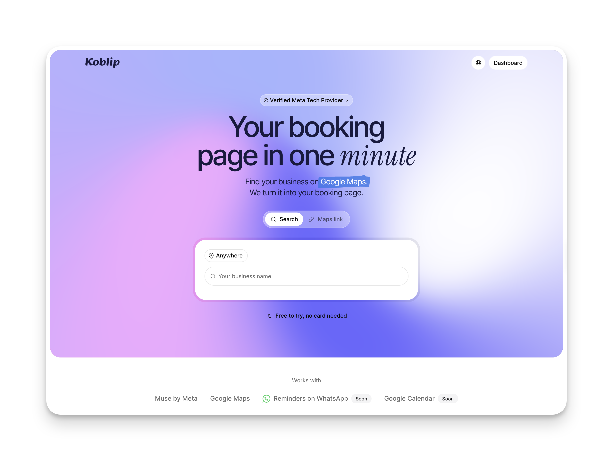

<h1 align="center">Koblip Book</h1>

<p align="center">
  <strong>Your booking page in one minute.</strong><br>
  Find your business on Google Maps. Share your page. Manage the day by typing or talking.
</p>

<p align="center">
  <a href="https://book.koblip.com"><strong>Try Koblip Book →</strong></a> ·
  <a href="docs/README.md">Documentation</a> ·
  <a href="docs/setup.md">Run locally</a>
</p>

<p align="center">
  <a href="https://github.com/MackentochKelly/koblip-book/actions/workflows/ci.yml">
    
  </a>
</p>

<p align="center">
  <a href="https://book.koblip.com">
    
  </a>
</p>

## Less scheduling. More time for your business.

Koblip Book helps local businesses get online and take appointments. Customers book through a public page; owners manage bookings, services, opening hours, customers and team from one dashboard.

| Start                                                     | Share                                                                  | Manage                                                    |
| --------------------------------------------------------- | ---------------------------------------------------------------------- | --------------------------------------------------------- |
| Find your business by name or paste its Google Maps link. | Give customers a booking page with services, team and available times. | Use the dashboard or ask your assistant by text or voice. |

- **An assistant that works with your business:** looks up bookings and helps manage appointments, services and hours. Actions that need confirmation show a card for the owner to approve.
- **English and Spanish:** for customer pages and the owner experience.
- **Phone first:** with desktop layouts and light and dark themes.

## Built for the Meta Global AI Developer Hackathon

Development in this repository began on **October 26, 2026**. The project combines Google Maps business setup, online booking and an owner assistant powered by Meta's models through the Meta Model API. Spoken replies use ElevenLabs.

[Explore the app](https://book.koblip.com) · [Assistant design notes](docs/assistant-plan.md)

## Built by Mackentoch Kelly Begin

Founder of Koblip. Building software that helps businesses work with less friction.

[X](https://x.com/keke_tuto) · [GitHub](https://github.com/MackentochKelly) · [LinkedIn](https://www.linkedin.com/in/mkellybegin/)

<details>
<summary><strong>Development · local setup, architecture and checks</strong></summary>

### Run locally

Use **Node.js 24**, as specified in `.nvmrc` and CI.

```bash
npm ci
cp .env.example .env.local
mkdir -p data
```

Fill in the settings described in [Local setup](docs/setup.md), then run:

```bash
npm run db:migrate
PORT=3100 npm run dev
```

Open [localhost:3100](http://localhost:3100). Google search, model responses, spoken replies and email each require their own credentials; see the setup guide.

### Project structure

```text
app/           Routes, layouts and API endpoints
features/      Feature code, translations and colocated tests
components/    Shared components; UI primitives in components/ui
hooks/         Shared React hooks
lib/           Shared services, rules, database schema and utilities
server/        Live voice WebSocket relay
drizzle/       Database migrations
public/        Static assets and audio worklet
scripts/       Maintenance and import commands
types/         Shared TypeScript types
docs/          Setup, architecture, UI standards and project notes
```

Built with Next.js, React, TypeScript, Tailwind CSS, shadcn components, Drizzle, SQLite/libSQL and Better Auth. [Architecture](docs/architecture.md) describes code boundaries and the voice server.

### Quality checks

```bash
npm run typecheck
npm run lint
npm test
npm run build
```

CI runs these checks on pushes and pull requests. Tests live beside the code they cover. External model evaluations are opt-in and excluded from the normal test run.

### Working on the project

Read [AGENTS.md](AGENTS.md) for repository conventions and the [UI checklist](docs/ui-rules/checklist.md) before changing the interface. Keep credentials in the ignored `.env.local`; `.env.example` contains variable names and placeholders only.

The [documentation index](docs/README.md) links to setup, design rules, technical notes and dated reviews. Historical task briefs are archived separately from current development guidance.

</details>
